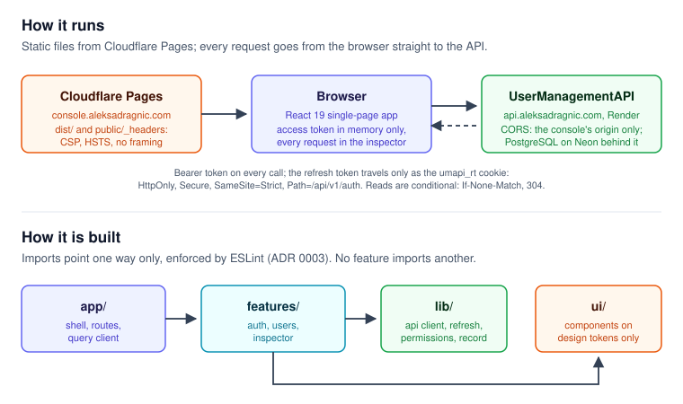

# Architecture

A guide to where things are and why. The decisions behind it are the
[ADRs](adr/README.md); the plan it was built from is [BUILD-PLAN.md](BUILD-PLAN.md).



## How it runs

Static files on Cloudflare Pages, and nothing else of its own. The browser
loads the bundle from `console.aleksadragnic.com` and calls the API at
`api.aleksadragnic.com` directly. The API's CORS allows this origin only, and
the refresh cookie needs the same site, so a copy served from anywhere else
cannot sign in. `public/_headers` gives every response its security headers
(ADR 0015).

## Layers

```
src/
├── app/         Routes, providers, the shell, the error boundary
├── features/
│   ├── auth/       Sign-in, the session, the boot screen, permission gates
│   ├── users/      The directory, the detail and its writes, the roles
│   └── inspector/  The docked panel that shows every request
├── lib/
│   ├── api/        The clients, refresh, the request record, problem details
│   ├── design/     Token permission sets and the contrast and usage tests
│   └── testing/    The mock of the API: MSW handlers, factories, scenario
└── ui/          Components on design tokens only: Button, Table, Dialog...
```

Imports point one way: `app` → `features` → `lib`, and everything may use
`ui`. `ui` imports no feature and nothing from `app`, no feature imports
another, and production code does not import the mock; ESLint enforces each of
these (ADR 0003, `eslint.config.js`). `src/lib/design/usage.test.ts` enforces
where colours may appear: no literal colour, no tier 1 token, no Tailwind
default palette, status colours in two files only (ADR 0004).

## A request

1. A screen calls a function in its feature's `api.ts` (`fetchDirectory`,
   `fetchUser`) or a write in `changes.ts`, through TanStack Query (ADR 0010).
2. The call goes through `api`, an `openapi-fetch` client typed from the
   generated `src/lib/api/schema.d.ts` (ADR 0006). Reads send the validator
   they kept, `If-None-Match`, and a 304 keeps the cached data (ADR 0013).
   Writes send the detail's `version` as `If-Match`.
3. Its middleware sends the access token from memory, and meets a 401 with one
   refresh shared by every request waiting on it, then a replay (ADR 0008,
   `lib/api/refresh.ts`). A success that is not JSON is stopped as a server
   error (`lib/api/not-json.ts`).
4. The transport (`create-client.ts`) records the request and its answer for
   the inspector, redacted, before anything else reads them (ADR 0014).
5. A refusal becomes problem details (`lib/api/problem.ts`), and the screen
   chooses its state from the status and the error code - never from the
   wording.

## The session

The access token lives in memory only (`lib/api/access-token.ts`, the session
provider in `features/auth/session.tsx`). The refresh token never reaches
JavaScript: it is an `HttpOnly` cookie on `/api/v1/auth` (ADR 0007). On load,
the boot screen asks the API for a token with that cookie before any route
decides who the user is. Permissions come from the token's claims, the same
ones the API checks (ADR 0009).

## Where to look

| To change | Start at |
|---|---|
| What a screen shows in each state | `docs/SCREEN-INVENTORY.md`, then the screen in `features/` |
| How the console reads an API behaviour | `docs/OBSERVED-BEHAVIOUR.md`, then `lib/testing/handlers/` |
| Colours, type, spacing | `docs/DESIGN-DECISIONS.md` and `docs/tokens.css` |
| A route | `src/app/AppRoutes.tsx` |
| Headers the console sends | `public/_headers` and `src/lib/api/security-headers.test.ts` |
| Why something is the way it is | `docs/adr/`, then build plan section 14 |
